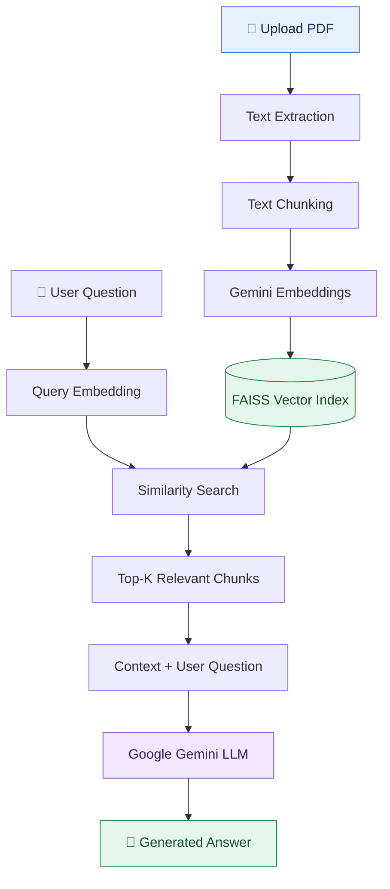
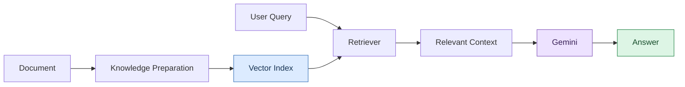
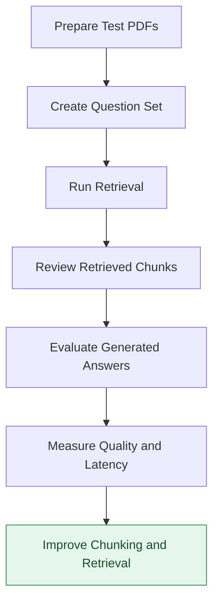

# 🚀 RAG-Based PDF Chat Application

### Chat with your PDFs using Retrieval-Augmented Generation (RAG)

Upload a PDF, ask questions in natural language, and receive AI-generated answers grounded in the document's content. This project combines semantic search and Google's Gemini AI to make document understanding more interactive and efficient.

<p align="center">
  <a href="https://rag-pdf-chat-application-h5cxmzumrxnqbn7nd8zvvw.streamlit.app/">
    <strong>🌐 Try the Live Application</strong>
  </a>
</p>

<p align="center">
  
  
  
  
  
</p>

---

## 📌 Project Overview

Reading lengthy documents to find specific information can be time-consuming. Traditional keyword searches may also miss relevant passages when a question uses different wording from the original document.

The **RAG-Based PDF Chat Application** addresses this challenge by combining document retrieval with generative AI.

Users can upload a PDF and ask questions about its contents. The application extracts the document text, divides it into smaller chunks, converts those chunks into embeddings, and indexes them using FAISS. When a question is submitted, the system retrieves relevant passages and provides them as context to a Gemini model to generate an answer.

### ✨ Key Capabilities

- 📄 **PDF-Based Question Answering:** Ask natural-language questions about an uploaded document.
- 🔍 **Semantic Search:** Find relevant passages based on meaning, not just exact keyword matches.
- 🧠 **AI-Powered Responses:** Use Google Gemini to generate answers from retrieved document context.
- ⚡ **Vector Similarity Search:** Use FAISS to retrieve relevant text chunks efficiently.
- 🖥️ **Interactive Web Interface:** Upload documents and interact with the application through Streamlit.
- 🧩 **Modular RAG Pipeline:** Separate document processing, retrieval, and answer generation into understandable stages.

---

## 🏗️ System Architecture

The application follows a Retrieval-Augmented Generation architecture. Instead of relying only on a language model's general knowledge, it retrieves relevant content from the uploaded document and uses that content to answer the question.



### 🔄 How the RAG Pipeline Works

| Stage | Process | Purpose |
|---|---|---|
| 1 | PDF upload | Accept the document from the user |
| 2 | Text extraction | Extract readable text from the PDF |
| 3 | Chunking | Divide long text into smaller, manageable sections |
| 4 | Embedding generation | Represent text chunks as numerical vectors |
| 5 | FAISS indexing | Organize vectors for similarity search |
| 6 | Query embedding | Convert the user's question into a vector |
| 7 | Retrieval | Find the most relevant document chunks |
| 8 | Prompt construction | Combine the question with retrieved context |
| 9 | Answer generation | Use Gemini to generate a response |

---

## 🧠 Understanding the RAG Workflow



**Why use RAG?**

- It provides the model with relevant information from the uploaded PDF.
- It can reduce unsupported answers compared with asking the model without document context.
- It makes it possible to answer questions about content that may not be included in the model's general knowledge.

RAG does not guarantee that every answer is correct. Results depend on document quality, retrieval relevance, prompt design, and model behavior.

---

## 🛠️ Technology Stack

| Technology | Role in the Project |
|---|---|
| Python | Core programming language and application logic |
| Streamlit | Web interface for PDF uploads and question answering |
| LangChain Text Splitter | Divides extracted text into manageable chunks |
| FAISS | Indexes embeddings and retrieves similar vectors |
| Google Gemini API | Generates answers using retrieved document context |
| Gemini Embeddings | Converts text and questions into vector representations |
| python-dotenv | Loads environment variables from a `.env` file, if configured |

### Why These Technologies?

- **Python:** Provides a practical ecosystem for AI, data processing, and application development.
- **Streamlit:** Makes it possible to build an interactive Python web application without creating a separate frontend.
- **FAISS:** Supports efficient similarity search across vector representations.
- **Gemini:** Provides embedding and generative AI capabilities through Google's API.
- **LangChain Text Splitter:** Helps organize long documents into smaller sections that can be retrieved independently.

---

## 💻 Installation and Setup

Follow these instructions to run the project locally on Windows.

### Prerequisites

- Python installed
- pip package manager
- Git (optional, for cloning the repository)
- A Google Gemini API key
- The project source code and `requirements.txt`

### 1. Clone the Repository

If your repository is hosted on GitHub, clone it using:

```powershell
git clone YOUR_GITHUB_REPOSITORY_URL
cd YOUR_REPOSITORY_FOLDER
```

Replace the placeholders with your actual repository URL and folder name.

Alternatively, download the project ZIP and open its folder in VS Code.

### 2. Create a Virtual Environment

```powershell
py -m venv .venv
```

Activate it:

```powershell
.\.venv\Scripts\Activate.ps1
```

If PowerShell blocks activation, run:

```powershell
Set-ExecutionPolicy -Scope Process -ExecutionPolicy Bypass
.\.venv\Scripts\Activate.ps1
```

### 3. Install Dependencies

```powershell
python -m pip install --upgrade pip
pip install -r requirements.txt
```

### 4. Configure the Gemini API Key

Create a `.env` file in the project root, following the structure below:

```env
GEMINI_API_KEY=your_real_api_key
```

Keep the actual key private. Ensure `.env` is included in `.gitignore` and never commit it to GitHub.

If the application uses `python-dotenv`, load the environment variables in `app.py`:

```python
from dotenv import load_dotenv

load_dotenv()
```

The environment variable name must match the one used by your application code.

### 5. Run the Application

```powershell
streamlit run app.py
```

Open the local URL printed in the terminal. It is usually:

`http://localhost:8501`

---

## 📂 Suggested Project Structure

The following is a suggested structure. Keep the actual filenames in your repository if they differ.

```text
rag-pdf-chat-application/
│
├── app.py                 # Streamlit application
├── requirements.txt       # Python dependencies
├── .env.example           # Example environment configuration
├── .gitignore             # Files excluded from Git
├── README.md              # Project documentation
└── .env                   # Private API key; do not commit
```

---

## 📊 Performance and Evaluation

A RAG application should be evaluated on retrieval quality and answer quality, not only on whether it successfully generates text.

The following metrics are useful if you decide to add an evaluation module:

| Metric | What It Measures |
|---|---|
| Retrieval Precision@K | How many of the top-K retrieved chunks are relevant |
| Retrieval Recall@K | How many relevant chunks are retrieved among the top K |
| Answer Relevance | Whether the answer addresses the user's question |
| Faithfulness | Whether the generated answer is supported by the retrieved context |
| Response Latency | How long the system takes to produce an answer |
| Token/API Usage | The amount of model usage per request |

These are **proposed evaluation metrics**, not measured results from the current application.

### Example Evaluation Workflow



For a future version, you could record evaluation results and display them as bar charts or line charts. Only publish numerical charts after collecting actual measurements.

---

## ⚠️ Current Limitations

- The FAISS index is held in memory and is not saved to disk.
- Scanned or image-only PDFs may not produce readable text without OCR.
- Answer quality depends on the extracted text and the relevance of retrieved chunks.
- Gemini API access, quotas, latency, and availability can affect responses.
- The current application is designed around uploaded PDF content rather than a persistent document knowledge base.

---

## 🚀 Future Enhancements

- [ ] Add OCR support for scanned PDFs.
- [ ] Persist FAISS indexes to reduce repeated processing.
- [ ] Support multiple PDFs in a single knowledge base.
- [ ] Add source references or page-level citations to answers.
- [ ] Add configurable chunk size, chunk overlap, and Top-K retrieval.
- [ ] Build a retrieval and answer evaluation dashboard.
- [ ] Add document-processing progress and clearer error messages.
- [ ] Add conversation history and follow-up questions.
- [ ] Improve API-key handling and deployment configuration.

---

## 🔐 Security Considerations

- Never expose your Gemini API key in source code, screenshots, public logs, or GitHub commits.
- Store secrets in environment variables or a secure deployment secrets manager.
- Restrict access to the application if uploaded documents may contain confidential information.
- Review API usage and provider quotas before making the application publicly accessible.

---

## 👨‍💻 What I Learned

Through this project, I explored:

- Building an interactive AI application using Python and Streamlit.
- Extracting and preparing PDF text for downstream processing.
- Understanding chunking, embeddings, vector indexing, and semantic retrieval.
- Connecting a vector search pipeline with a generative language model.
- Managing environment variables and configuring an application for deployment.
- Understanding the trade-offs between retrieval quality, answer relevance, latency, and API usage.

---

## 🌐 Live Application

**Try it here:** [RAG-Based PDF Chat Application](https://rag-pdf-chat-application-h5cxmzumrxnqbn7nd8zvvw.streamlit.app/)

Upload a readable PDF, ask a question about its contents, and explore how document retrieval and generative AI work together.

---

## 👤 Author

**Abhishek Dubey**

B.Tech Computer Science Graduate | Python | SQL | Generative AI | Retrieval-Augmented Generation

This project demonstrates my practical exploration of document processing, semantic search, vector databases, and LLM-powered applications.

